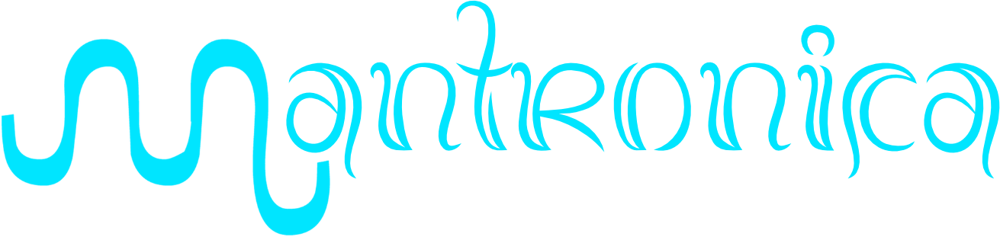

<h3>An engineering community helping small businesses grow.</h3>

📍 Bali, Indonesia

---

Mantronica is a community of engineers focused on the development of UMKM (*Usaha Mikro, Kecil, dan Menengah*), Indonesia's micro, small, and medium enterprises. We bring engineering skills to the businesses that power local economies.

## 💫 About Us:

- 🛠️ Engineers working together to support SMEs
- 🏪 Focused on practical solutions for real business needs
- 🤝 Sharing knowledge and growing together as a community
- 🌏 Based in Bali, Indonesia

## 🌐 Socials:

<!-- Add more socials by replacing the handle or address, then uncommenting:

-->

## 💻 Tech Stack:

What we've used across our projects so far:

## 📊 GitHub Stats:

